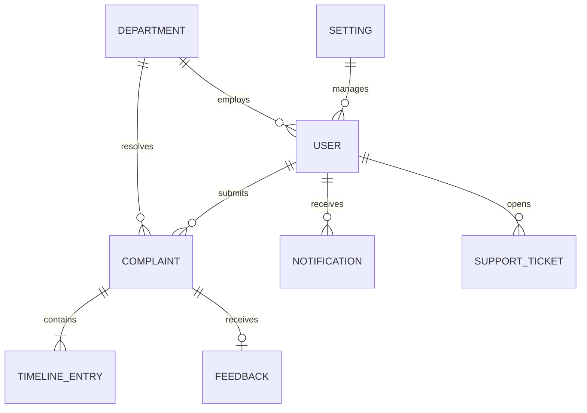

# MongoDB Database Schemas & Architecture

This document provides a comprehensive technical reference for the data models, collections, indexes, and polymorphic entities used in the **Smart Civic Complaint & Issue Management System**.

---

## 1. Overview & Data Design

The database is built on **MongoDB** using the **Mongoose** Object Data Modeling (ODM) library. The primary design goals are:
- **Fast lookups and filtering** for civic administrators triaging thousands of municipal complaints.
- **Auditability and transparency** through embedded timeline histories and citizen feedback.
- **Role separation** supporting citizens, municipal department field staff, and city administrators.
- **AI integration** storing category/priority predictions, confidence scores, and deduplication vectors.

### Database Name
- **Default Database**: `smart_civic_db`
- **Connection URI Format**: `mongodb://localhost:27017/smart_civic_db` or MongoDB Atlas replica set URI via `MONGO_URI`.



---

## 2. Collections Reference

The system utilizes five primary collections:
1. `users` (and specialized `citizens`, `admins`, `departments` collections)
2. `complaints`
3. `notifications`
4. `settings`
5. `supporttickets`

---

## 3. Users Collection (`users` / polymorphic: citizen, admin, department)

The system supports a unified polymorphic user model (`User`) alongside optimized specialized collections (`Citizen`, `Admin`, `Department`) for role-tailored authentication and query indexing.

### Schema Definition

| Field | Type | Required | Default | Description |
| :--- | :--- | :---: | :--- | :--- |
| `_id` | `ObjectId` | Auto | Generated | MongoDB document identifier |
| `userId` | `String` | No | `null` | Unique identifier format (e.g., `USR-1001`) |
| `name` | `String` | **Yes** | — | Full name of the user or representative |
| `email` | `String` | **Yes** | — | Unique, lowercase email address (validated with regex) |
| `phone` | `String` | **Yes** | — | Contact telephone number |
| `password` | `String` | **Conditional** | — | Bcrypt hashed password (salt factor 10, hidden via `select: false`). Required if `authProvider === 'local'` |
| `role` | `String` | **Yes** | `'citizen'` | Role enum: `citizen`, `department`, `admin` |
| `authProvider` | `String` | No | `'local'` | Authentication source: `'local'` or `'google'` |
| `googleId` | `String` | No | `null` | Unique Google OAuth 2.0 Subject ID |
| `department` | `ObjectId` | No | `null` | Reference to `Department` document (for department users) |
| `departmentName`| `String` | No | `null` | Denormalized department name for rapid display |
| `ward` | `String` | No | `'Ward 12 - Central Gwalior'` | Administrative municipal ward |
| `area` | `String` | No | `'City Center'` | Neighborhood or locality name |
| `city` | `String` | No | `'Gwalior'` | Municipality / City name |
| `state` | `String` | No | `'Madhya Pradesh'` | State or province |
| `language` | `String` | No | `'English'` | Preferred user interface language |
| `status` | `String` | No | `'Active'` | Account status: `'Active'`, `'Inactive'`, `'Suspended'` |
| `avatar` | `String` | No | `null` | URL or relative path to user profile image |
| `profilePic` | `String` | No | `null` | Alias for avatar photo |
| `lastActive` | `Date` | No | `Date.now` | Last activity or session heartbeat |
| `resetPasswordToken` | `String` | No | `null` | SHA-256 hashed password reset token |
| `resetPasswordExpires` | `Date` | No | `null` | Expiry timestamp for password reset token |
| `createdAt` | `Date` | Auto | `Date.now` | Document creation timestamp |
| `updatedAt` | `Date` | Auto | `Date.now` | Document last update timestamp |

### Citizen-Specific Fields

| Field | Type | Default | Description |
| :--- | :--- | :--- | :--- |
| `complaintCount` | `Number` | `0` | Total complaints filed by this citizen |
| `resolvedComplaints` | `Number` | `0` | Number of complaints successfully resolved |
| `activity` | `Array<Activity>` | `[]` | Embedded audit trail of user actions |

**Citizen Activity Sub-schema (`activity[]`):**
```json
{
  "_id": "ObjectId",
  "desc": "Submitted complaint CMP-1024",
  "time": "2 hours ago",
  "timestamp": "2026-10-28T06:00:00.000Z"
}
```

### Department-Specific Fields

| Field | Type | Default | Description |
| :--- | :--- | :--- | :--- |
| `code` | `String` | Unique, Uppercase | Short uppercase identifier (e.g., `ROAD`, `SANI`, `ELEC`) |
| `head` | `String` | `''` | Name of the Department Officer / Chief |
| `officeLocation` | `String` | `''` | Physical office address or depot zone |
| `iconName` | `String` | `'Building2'` | Lucide icon identifier for UI rendering |
| `categories` | `Array<String>` | `[]` | Categories handled (e.g., `['Road Damage', 'Pothole']`) |
| `staffCount` | `Number` | `0` | Total operational field staff count |
| `totalComplaints` | `Number` | `0` | Aggregated count of assigned issues |
| `pendingComplaints` | `Number` | `0` | Active pending issues |
| `inProgressComplaints` | `Number` | `0` | Issues currently under field repair |
| `resolvedComplaints` | `Number` | `0` | Successfully resolved issues |
| `resolutionRate` | `Number` | `0` | Percentage of resolved issues (0 - 100) |
| `averageResolutionTime` | `String` | `'0 days'` | Calculated average time to resolution |
| `staff` | `Array<StaffMember>` | `[]` | Embedded list of registered personnel |

**Staff Sub-schema (`staff[]`):**
```json
{
  "_id": "ObjectId",
  "staffId": "STF-201",
  "name": "Jane Smith",
  "designation": "Senior Field Officer",
  "phone": "+91 98234 11223"
}
```

### Indexes for Users
- `email`: Unique index (`{ email: 1 }, { unique: true }`)
- `userId`: Sparse unique index (`{ userId: 1 }, { unique: true, sparse: true }`)
- `role`: Standard index (`{ role: 1 }`)
- `department`: Sparse index (`{ department: 1 }`)

---

## 4. Complaints Collection (`complaints`)

The complaints collection represents civic grievances submitted by citizens, routed to departments, and resolved by municipal field staff.

### Schema Definition

| Field | Type | Required | Default | Description |
| :--- | :--- | :---: | :--- | :--- |
| `_id` | `ObjectId` | Auto | Generated | MongoDB document identifier |
| `complaintId` | `String` | **Yes** | — | Unique civic reference number (e.g. `CMP-1024` or `SC-2026-0042`) |
| `title` | `String` | **Yes** | — | Concise issue summary (e.g., "Large pothole on main road") |
| `description` | `String` | **Yes** | — | Detailed description of the civic problem |
| `category` | `String` | **Yes** | `'Other'` | Enum: `'Road Damage'`, `'Garbage'`, `'Streetlight'`, `'Water'`, `'Drainage'`, `'Traffic'`, `'Environment'`, `'Other'` |
| `priority` | `String` | **Yes** | `'Medium'` | Enum: `'Low'`, `'Medium'`, `'High'` |
| `severity` | `String` | **Yes** | `'Medium'` | Enum: `'Low'`, `'Medium'`, `'High'`, `'Critical'` |
| `status` | `String` | **Yes** | `'Pending'` | Enum: `'Pending'`, `'Assigned'`, `'In Progress'`, `'Resolved'`, `'Rejected'` |
| `citizen` | `ObjectId` | **Yes** | — | Reference to `Citizen` / `User` document |
| `citizenName` | `String` | **Yes** | — | Denormalized citizen name |
| `citizenPhone` | `String` | **Yes** | — | Denormalized citizen phone number |
| `department` | `ObjectId` | No | `null` | Reference to `Department` document |
| `departmentName`| `String` | No | `'Unassigned'`| Denormalized department title |
| `location.lat` | `Number` | **Yes** | — | Latitude GPS coordinate |
| `location.lng` | `Number` | **Yes** | — | Longitude GPS coordinate |
| `area` | `String` | **Yes** | — | Locality name (e.g., Thatipur, Lashkar, Morar, City Center) |
| `address` | `String` | **Yes** | — | Street address or landmark description |
| `image` | `String` | No | `null` | Path or URL to citizen's photo attachment |
| `resolutionImage`| `String` | No | `null` | Path or URL to proof-of-work photo submitted upon resolution |
| `timeline` | `Array<TimelineEntry>` | No | `[]` | Chronological transition history |
| `feedback` | `Object` | No | Subdoc | Citizen rating and commentary |
| `feedback.rating`| `Number` | No | `null` | Integer rating between 1 and 5 |
| `feedback.comment`| `String` | No | `null` | Review text |
| `feedback.submittedAt`| `Date` | No | `null` | Timestamp when feedback was submitted |
| `resolvedAt` | `Date` | No | `null` | Timestamp when status was set to `'Resolved'` |
| `aiAnalysis` | `Object` | No | Subdoc | AI classification and inference telemetry |
| `aiAnalysis.detectedCategory` | `String` | No | `null` | Category predicted by NLP model |
| `aiAnalysis.detectedPriority` | `String` | No | `null` | Priority predicted by ML classifier |
| `aiAnalysis.confidence` | `Number` | No | `null` | Confidence score between 0.00 and 1.00 |
| `aiAnalysis.processed` | `Boolean` | No | `false` | Flag indicating whether AI evaluation finished |
| `createdAt` | `Date` | Auto | `Date.now` | Issue submission timestamp |
| `updatedAt` | `Date` | Auto | `Date.now` | Last status/field update timestamp |

### Timeline Entry Sub-schema (`timeline[]`)

```json
{
  "_id": "ObjectId",
  "status": "In Progress",
  "date": "2026-10-28T08:30:00.000Z",
  "note": "Field crew dispatched with asphalt patch kit",
  "updatedBy": "651a2b3c4d5e6f7a8b9c0d1e",
  "updatedByName": "Rajesh Verma"
}
```

### Indexes for Complaints
- `complaintId`: Unique index (`{ complaintId: 1 }, { unique: true }`)
- `status`: Index (`{ status: 1 }`)
- `category`: Index (`{ category: 1 }`)
- `priority`: Index (`{ priority: 1 }`)
- `citizen`: Index (`{ citizen: 1 }`)
- `department`: Index (`{ department: 1 }`)
- `area`: Index (`{ area: 1 }`)
- **Compound Dashboard Query Index**:
  ```javascript
  complaintSchema.index({
    status: 1,
    category: 1,
    priority: 1,
    departmentName: 1,
    area: 1
  });
  ```

---

## 5. Notifications Collection (`notifications`)

Stores real-time alerts and inbox events delivered to citizens, department personnel, or municipal supervisors.

### Schema Definition

| Field | Type | Required | Default | Description |
| :--- | :--- | :---: | :--- | :--- |
| `_id` | `ObjectId` | Auto | Generated | MongoDB document identifier |
| `notificationId`| `String` | No | Generated | Unique identifier (e.g., `NOTIF-3001`) |
| `recipient` | `ObjectId` | No | `null` | Reference to `User` / `Citizen` (`null` for broadcasts) |
| `recipientRole` | `String` | No | `'all'` | Target audience: `'all'`, `'admin'`, `'department'`, `'citizen'` |
| `type` | `String` | No | `'complaint'` | Enum: `'complaint'`, `'department'`, `'user'`, `'system'` |
| `title` | `String` | **Yes** | — | Concise notification title |
| `message` | `String` | **Yes** | — | Primary notification text message |
| `description` | `String` | No | `''` | Expanded contextual detail |
| `priority` | `String` | No | `'Medium'` | Enum: `'Low'`, `'Medium'`, `'High'` |
| `read` | `Boolean` | No | `false` | Read status flag |
| `relatedEntity` | `String` | No | `'complaint'` | Target entity type: `'complaint'`, `'department'`, `'user'`, `'system'` |
| `relatedId` | `String` | No | `''` | ID of associated record (e.g. `CMP-1024`) |
| `area` | `String` | No | `''` | Geographic filter scope if applicable |
| `sender` | `String` | No | `'Smart Civic System'`| Originator display label |
| `category` | `String` | No | `'Complaint Updates'`| Enum: `'Complaint Updates'`, `'Department Updates'`, `'User Accounts'`, `'System Operations'` |
| `createdAt` | `Date` | Auto | `Date.now` | Creation timestamp |
| `updatedAt` | `Date` | Auto | `Date.now` | Last update timestamp |

### Indexes for Notifications
- `recipient`: Index (`{ recipient: 1 }`)
- `recipientRole`: Index (`{ recipientRole: 1 }`)
- `read`: Index (`{ read: 1 }`)
- Compound index for unread inbox fetch: `{ recipient: 1, read: 1, createdAt: -1 }`

---

## 6. Settings Collection (`settings`)

Contains municipal system-wide configurations, notification triggers, and operational parameters. Supports both document-level structured settings and key/value extensibility.

### Structured Schema Definition

| Field | Type | Default | Description |
| :--- | :--- | :--- | :--- |
| `_id` | `ObjectId` | Generated | MongoDB document identifier |
| `orgName` | `String` | `'Smart Civic Complaint System'` | Official municipal portal organization title |
| `adminEmail` | `String` | `'admin@civis.gov'` | Primary administrator contact email |
| `phone` | `String` | `'+91 98765 43210'` | Municipal helpline phone number |
| `timeZone` | `String` | `'Asia/Kolkata (IST)'` | Default timezone display format |
| `language` | `String` | `'English'` | Default locale language |
| **`notifications`** | `Object` | Nested flags | System event notification triggers: |
| `notifications.newComplaint` | `Boolean` | `true` | Notify admin on complaint submission |
| `notifications.highPriority` | `Boolean` | `true` | Send immediate alert for high severity issues |
| `notifications.statusUpdates`| `Boolean` | `true` | Notify citizen when status changes |
| `notifications.newUserReg` | `Boolean` | `false` | Alert admins on new citizen signup |
| `notifications.deptAssignment`| `Boolean` | `true` | Notify department when issue is routed |
| `notifications.emailNotifs` | `Boolean` | `true` | Enable outgoing SMTP email alerts |
| **`preferences`** | `Object` | Nested flags | Dashboard behavior & UI preferences: |
| `preferences.defaultStatus` | `String` | `'Pending'` | Default initial status for newly logged issues |
| `preferences.complaintsPerPage`| `Number` | `10` | Default pagination page size |
| `preferences.autoRefresh` | `Boolean` | `true` | Enable automatic dashboard data polling |
| `preferences.refreshInterval` | `String` | `'30 seconds'` | Polling cadence interval |
| `preferences.dateFormat` | `String` | `'DD/MM/YYYY'` | Display date formatting |
| `preferences.maintenanceMode`| `Boolean` | `false` | System maintenance lock flag |
| `key` | `String` | `null` | Key for key-value pair extensibility |
| `value` | `Mixed` | `null` | Value for key-value pair extensibility |
| `description` | `String` | `null` | Human-readable explanation of setting |
| `updatedBy` | `ObjectId` | `null` | Reference to admin user who modified setting |
| `createdAt` | `Date` | `Date.now` | Creation timestamp |
| `updatedAt` | `Date` | `Date.now` | Last update timestamp |

---

## 7. SupportTickets Collection (`supporttickets`)

Tracks administrative and technical issues reported by staff, officers, or citizens regarding the platform itself.

### Schema Definition

| Field | Type | Required | Default | Description |
| :--- | :--- | :---: | :--- | :--- |
| `_id` | `ObjectId` | Auto | Generated | MongoDB document identifier |
| `ticketId` | `String` | **Yes** | — | Unique support ticket code (e.g. `TKT-8012`) |
| `subject` | `String` | **Yes** | — | Summary of the help inquiry |
| `category` | `String` | No | `'General'` | Category (e.g., `'Account'`, `'Bug Report'`, `'General'`) |
| `priority` | `String` | No | `'Medium'` | Priority enum: `'Low'`, `'Medium'`, `'High'` |
| `status` | `String` | No | `'Open'` | Status enum: `'Open'`, `'In Progress'`, `'Resolved'`, `'Closed'` |
| `description` | `String` | **Yes** | — | Detailed explanation of technical request |
| `supportResponse`| `String` | No | `''` | Resolution notes or response from system admin |
| `submittedBy` | `ObjectId` | No | `null` | Reference to `User` who filed the ticket |
| `submittedByName`| `String` | No | `'Admin User'` | Name of user who submitted ticket |
| `createdAt` | `Date` | Auto | `Date.now` | Creation timestamp |
| `updatedAt` | `Date` | Auto | `Date.now` | Last response/update timestamp |

### Indexes for SupportTickets
- `ticketId`: Unique index (`{ ticketId: 1 }, { unique: true }`)
- `status`: Index (`{ status: 1 }`)
- `submittedBy`: Index (`{ submittedBy: 1 }`)

---

## 8. Data Validation & Constraints Summary

| Model | Unique Keys | Enum Fields | Cascades / References |
| :--- | :--- | :--- | :--- |
| **User / Citizen** | `email`, `userId`, `googleId` | `role`, `status`, `authProvider` | Linked to Complaints via `citizen` |
| **Department** | `code`, `name`, `departmentId` | `status`, `role` | Linked to Complaints via `department` |
| **Complaint** | `complaintId` | `category`, `priority`, `severity`, `status` | References `Citizen` and `Department` |
| **Notification** | `notificationId` | `recipientRole`, `type`, `priority`, `relatedEntity`, `category` | References `User` (`recipient`) |
| **SupportTicket** | `ticketId` | `priority`, `status` | References `User` (`submittedBy`) |
