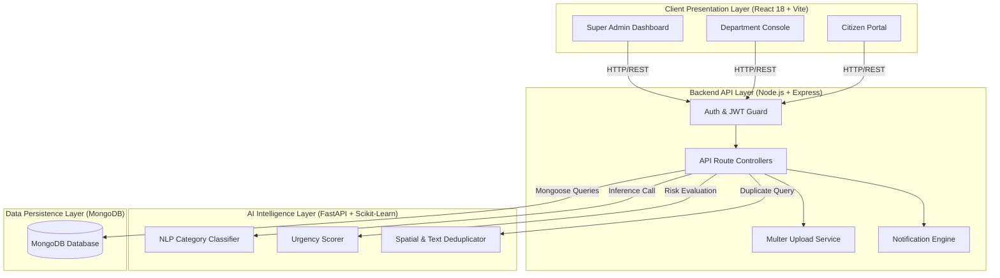
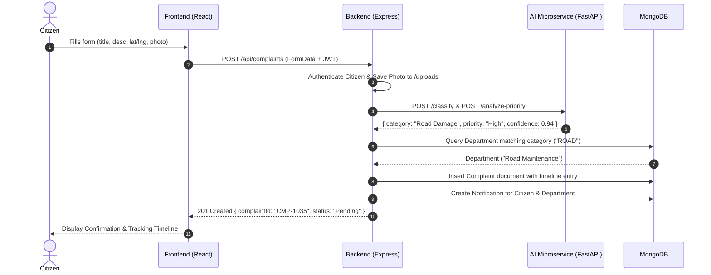
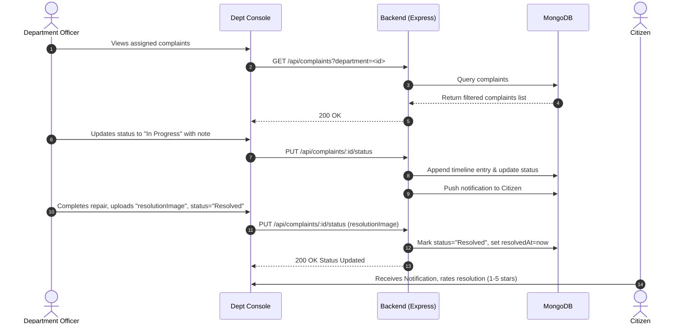

# Smart Civic Complaint & Issue Management System — System Architecture

This document outlines the high-level architecture, component topology, data flows, technology stack, and security architecture of the **Smart Civic Complaint & Issue Management System**.

---

## 1. High-Level Architecture Overview

The system is designed as a modular, service-oriented web architecture consisting of:
1. **Client Tier**: A responsive React SPA for Citizens, Municipal Departments, and System Administrators.
2. **Application Tier**: A Node.js + Express REST API handling business logic, authentication, file storage, and data validation.
3. **Intelligence Tier**: A Python FastAPI microservice executing Machine Learning classification, priority scoring, and duplicate detection.
4. **Data Tier**: A high-performance MongoDB document store indexing complaints, spatial coordinates, audit histories, and user credentials.

### Architectural Diagram

```text
+-----------------------------------------------------------------------------------------+
|                                    CLIENT TIER                                          |
|                                                                                         |
|   +-----------------------+   +---------------------------+   +---------------------+   |
|   |  Citizen Web Portal   |   | Department Staff Console  |   | Admin Dashboard     |   |
|   |  - Submit issues      |   | - Task queue              |   | - Triage & routing  |   |
|   |  - Map & Geo-locate   |   | - Status updates          |   | - Analytics & SLAs  |   |
|   |  - Track & Review     |   | - Proof-of-work uploads   |   | - User management   |   |
|   +-----------+-----------+   +-------------+-------------+   +----------+----------+   |
|               |                             |                            |              |
+---------------+-----------------------------+----------------------------+--------------+
                                              | HTTPS / REST (JSON & Multipart)
                                              v
+-----------------------------------------------------------------------------------------+
|                                   APPLICATION TIER                                      |
|                                                                                         |
|   +---------------------------------------------------------------------------------+   |
|   |                         Node.js + Express API Gateway (Port 5000)                |   |
|   |                                                                                 |   |
|   |   +-------------------+  +---------------------+  +-------------------------+   |   |
|   |   | Auth Middleware   |  | Multer File Storage |  | Role-Based Auth (RBAC)  |   |   |
|   |   | (JWT + Google SSO)|  | (/uploads)          |  | (Citizen/Dept/Admin)    |   |   |
|   |   +-------------------+  +---------------------+  +-------------------------+   |   |
|   |                                                                                 |   |
|   |   +-------------------+  +---------------------+  +-------------------------+   |   |
|   |   | Complaint Router  |  | Department Router   |  | Notification Dispatcher |   |   |
|   |   +-------------------+  +---------------------+  +-------------------------+   |   |
|   +---------------------------------------+-----------------------------------------+   |
+-------------------------------------------|---------------------------------------------+
                                            |
                    +-----------------------+-----------------------+
                    | Internal HTTP                                 | Mongoose ODM
                    v                                               v
+---------------------------------------+       +-----------------------------------------+
|           INTELLIGENCE TIER           |       |                DATA TIER                |
|                                       |       |                                         |
|  +---------------------------------+  |       |  +-----------------------------------+  |
|  |  Python FastAPI Microservice    |  |       |  |  MongoDB Server / Atlas           |  |
|  |  (Port 8000)                    |  |       |  |  Database: smart_civic_db         |  |
|  |                                 |  |       |  |                                   |  |
|  |  - TF-IDF Category Classifier   |  |       |  |  Collections:                     |  |
|  |  - Urgency & Severity Scorer    |  |       |  |  - complaints                     |  |
|  |  - Duplicate Geohash Matcher    |  |       |  |  - users / citizens / admins      |  |
|  |  - Scikit-Learn Model Pipelines |  |       |  |  - departments                    |  |
|  +---------------------------------+  |       |  |  - notifications                  |  |
|                                       |       |  |  - settings & supporttickets      |  |
+---------------------------------------+       +-----------------------------------------+
```



---

## 2. Component Descriptions

### 2.1 Frontend Client (React 18 SPA)
- Built with **React 18**, **Vite**, and **React Router 6**.
- **State & Context**: Provides centralized `AuthContext` to persist tokens, user profiles, and active permissions in `localStorage` under `civic_token`.
- **UI Engine**: Pure CSS design system using responsive layout primitives, CSS custom properties (`--primary`, `--bg-card`, `--border`), Lucide icons, and Recharts visualization components.
- **Geocoding & Maps**: Interactive coordinates picker with Google Maps JavaScript API integration and browser Geolocation API fallback.

### 2.2 Backend Gateway (Node.js + Express)
- Modular MVC design:
  - `controllers/`: Handles incoming requests, validates input, coordinates AI calls, and constructs responses.
  - `models/`: Mongoose schemas defining validation, indexing, and pre-save hooks (e.g., bcrypt password hashing).
  - `middlewares/`: JWT verification, role-based authorization guards, file upload parsing, and centralized error handling.
  - `constants/`: Unified authority for categories, status strings, priorities, and areas.

### 2.3 AI Microservice (Python FastAPI)
- High-concurrency asynchronous API serving ML inference pipelines.
- **Category Classification**: TF-IDF vectorization paired with a trained multinomial classifier that tags citizen grievances into actionable categories (Road Damage, Sanitation, Water, Electricity, etc.).
- **Urgency Scoring**: NLP rule & sentiment analyzer parsing critical safety keywords (e.g., "sparking wire", "open manhole", "school children") to escalate severity to `Critical` or `High`.
- **Duplicate Detection**: Combines text cosine similarity with Haversine spatial distance calculations to flag duplicate submissions within a 150-meter radius.

### 2.4 Data Tier (MongoDB)
- Document-oriented persistence enabling flexible schema progression.
- Indexed for ultra-fast query performance across multi-attribute filtering (Status, Category, Area, Priority).
- Polymorphic user structures enabling unified authentication with specialized profiles for citizens, departments, and administrators.

---

## 3. Core Data Flows

### 3.1 Complaint Submission & AI Classification Pipeline



---

### 3.2 Department Resolution Workflow



---

## 4. Technology Stack Summary

| Layer | Technology | Version | Purpose |
| :--- | :--- | :--- | :--- |
| **Frontend Framework** | React | `^19.2.8` / `18+` | Reactive Component UI |
| **Frontend Build Tool** | Vite | `^8.2.2` | Rapid HMR & Production Bundler |
| **Routing** | React Router DOM | `^7.18.3` | Client-Side SPA Routing |
| **Icons & Charts** | Lucide React, Recharts | Latest | Iconography & Analytics Visuals |
| **Backend Runtime** | Node.js (ES Modules) | `>=18.0.0` | Server Execution Environment |
| **HTTP Framework** | Express | `^4.21.2` | REST API Server |
| **Database ODM** | Mongoose | `^8.9.5` | Schema Modeling & Aggregation |
| **Authentication** | JSON Web Tokens & BcryptJS | Latest | Stateless Auth & Password Encryption |
| **Single Sign-On** | Google Auth Library | `^11.1.0` | Google Identity Services Verification |
| **File Uploads** | Multer | `^1.4.5-lts.1`| Local/Cloud Multi-part File Handling |
| **AI Framework** | Python & FastAPI | `3.11+` | High-performance Async Machine Learning API |
| **ML Engine** | Scikit-Learn, NumPy, Joblib | Latest | TF-IDF Vectorization, Text Classification |
| **Containerization** | Docker & Docker Compose | `3.8` | Reproducible Containerized Deployment |

---

## 5. Security Measures & Best Practices

1. **Password Encryption**:
   - Passwords hashed using `bcryptjs` with auto-generated salt (cost factor 10).
   - Password fields configured with `select: false` in Mongoose models to prevent accidental leakage in API queries.

2. **Stateless JWT Authorization**:
   - Access tokens digitally signed with HMAC-SHA256 and an environment-isolated `JWT_SECRET`.
   - Token payload contains minimal non-sensitive identity metadata (`id`, `role`).

3. **Role-Based Access Control (RBAC)**:
   - Dedicated role middleware (`authorize('admin', 'department')`) protecting critical routes.
   - Resource-level checks preventing citizens from altering complaints filed by other users.

4. **File Upload Hardening**:
   - Multer middleware enforces strict MIME-type whitelisting (`image/jpeg`, `image/png`, `image/webp`).
   - File size caps limited to 5MB per upload.
   - Generated filenames utilize cryptographically random timestamps and nonces to avoid path traversal attacks.

5. **Cross-Origin Resource Sharing (CORS)**:
   - Configured origin whitelisting honoring `CLIENT_URL` with credentials support.

6. **Input Validation & Sanitization**:
   - Strict Mongoose schema casting and regex validations preventing NoSQL injection.
   - Trimming and sanitization applied across textual fields.
